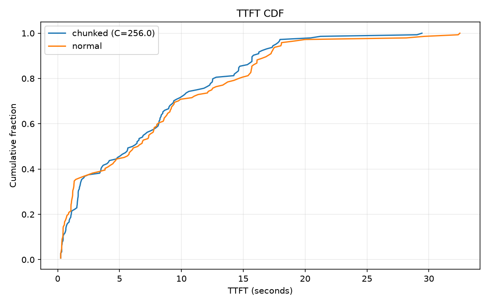
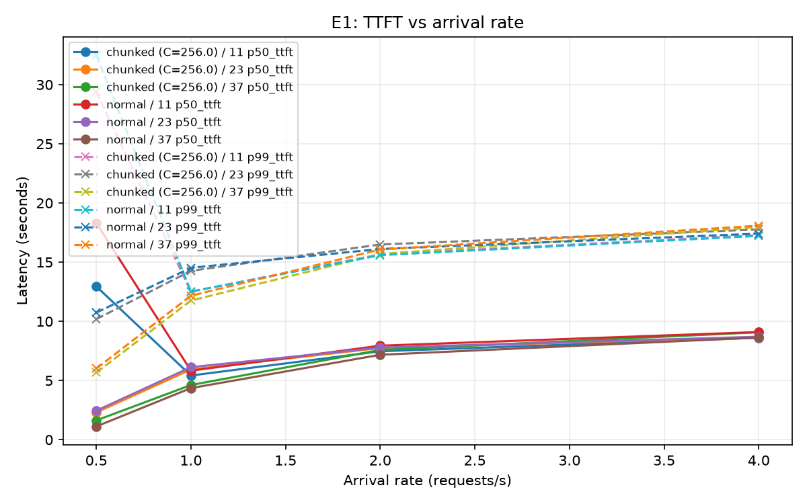
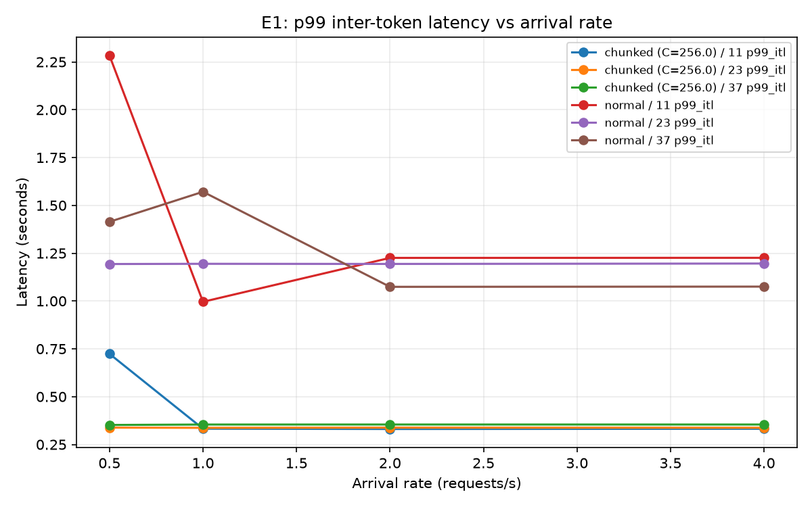
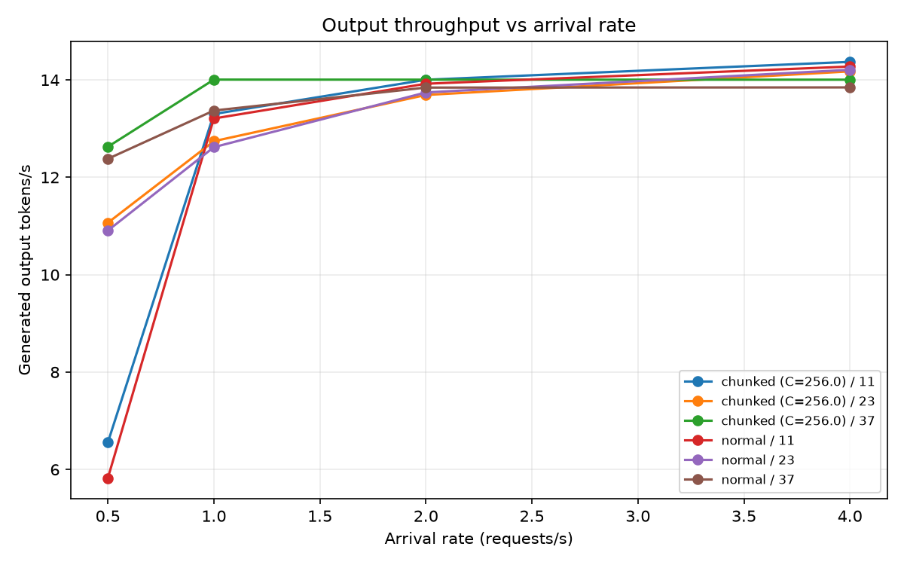
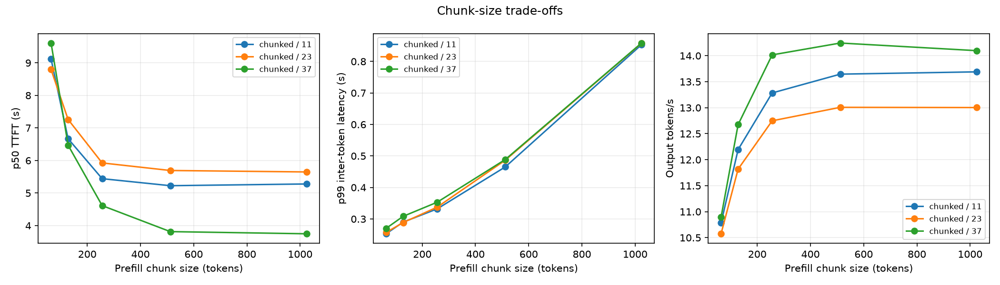
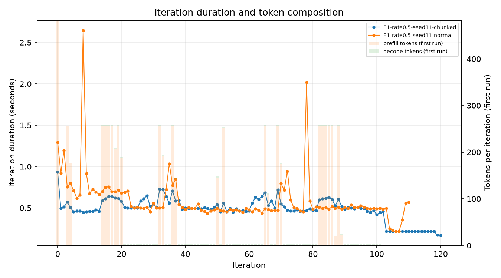
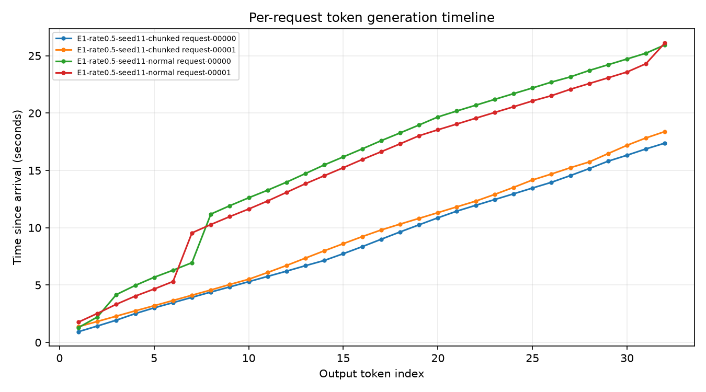

# Chunked Prefill Simulator

A real-model serving benchmark comparing prefill-prioritized scheduling with chunked prefill and decode-maximal batching. It uses Hugging Face model weights, a small custom inference loop, per-request KV caches, and wall-clock measurements from the selected device. It does **not** substitute synthetic latencies or call `model.generate()`.

The implementation follows the chunked-prefill approach described in [SARATHI](https://arxiv.org/abs/2308.16369). This project is a small single-GPU experiment, not a reproduction of the paper's hardware or model scale.

## Architecture

```text
YAML config
    |
Workload generator -- tokenizer --> timestamped requests
    |
Scheduler
    |-- Normal: whole prompt OR all active decodes per iteration
    `-- Chunked: whole remaining prompt when no decodes are active, otherwise one chunk + every active decode
    |
ModelRunner
    |-- shared token embedding / QKV / MLP projections
    |-- per-request causal attention against that request's KV cache
    `-- greedy next-token selection
    |
Simulator --> requests.csv, iterations.csv, summary.csv
    `------> matplotlib plots and measured_summary.md
```

The custom runner targets Hugging Face Llama/Qwen2-style causal models. It batches projections and MLPs across segments but runs attention separately per sequence, which keeps the cache and causal-mask logic explicit.

## Run natively on Windows (no Docker)

This project can run directly in Windows PowerShell; Docker and WSL2 are not required. You need a supported NVIDIA GPU, a current NVIDIA driver, internet access for the initial model download, and Python 3.11, 3.12, or 3.13.

1. In PowerShell, go to the project folder and create/activate a virtual environment:

   ```powershell
   py -3.12 -m venv .venv
   .\.venv\Scripts\Activate.ps1
   python -m pip install --upgrade pip
   ```

   If PowerShell blocks activation, skip activation and use `.\.venv\Scripts\python.exe` instead of `python` in the commands below.

2. Install CUDA-enabled PyTorch. For the project's PyTorch 2.5.1/CUDA 12.4 baseline, use:

   ```powershell
   python -m pip install torch==2.5.1 --index-url https://download.pytorch.org/whl/cu124
   ```

   The CUDA wheel includes the CUDA runtime libraries PyTorch needs; you still need a compatible NVIDIA driver. Do not install the macOS/CPU-only PyTorch build for this GPU run.

3. Install the project and confirm PyTorch sees the GPU:

   ```powershell
   python -m pip install -r requirements.txt
   python -m pip install -e .
   python -c "import torch; print('PyTorch:', torch.__version__); print('CUDA available:', torch.cuda.is_available()); print('GPU:', torch.cuda.get_device_name(0) if torch.cuda.is_available() else 'not detected')"
   ```

   Continue only if `CUDA available: True` and the expected GPU is printed.

4. Run the short smoke test, then the benchmark:

   ```powershell
   python -m cpsim.cli run --config configs/smoke.yaml --device cuda
   python -m cpsim.cli sweep --config configs/default.yaml --device cuda
   ```

The first run downloads the default model, `Qwen/Qwen2.5-0.5B-Instruct`, and tokenizer from Hugging Face. It needs internet access and several GB of free disk space for the model/cache. The model is ungated, so no Hugging Face token is normally needed. Results are saved under `results/`. Rebuild graphs from existing CSV results with:

```powershell
python -m cpsim.cli plot --results results
```

### Optional: Windows with Docker Desktop + WSL2

Docker is an alternative, not a requirement. If using it, install a current NVIDIA Windows driver, enable WSL2, and configure Docker Desktop's WSL2 backend and GPU integration. Verify GPU passthrough in PowerShell:

```powershell
docker run --rm --gpus all nvidia/cuda:12.4.1-base-ubuntu22.04 nvidia-smi
```

Then run from a WSL2-backed shell:

```bash
docker compose build
docker compose run --rm smoke
docker compose run --rm bench
docker compose run --rm plots
```

### Commands

```bash
# Short normal-vs-chunked smoke workload; writes CSV and PNG results.
docker compose run --rm smoke

# E1-E5 sweeps, with three configured seeds per experiment.
docker compose run --rm bench

# Regenerate graphs and the measured summary from existing result CSVs.
docker compose run --rm plots
```

For a custom run, edit `configs/default.yaml` or invoke the image directly:

```bash
docker compose run --rm sim run --config configs/default.yaml
docker compose run --rm sim sweep --config configs/default.yaml
docker compose run --rm sim plot --results results
```

The output directory is mounted at `./results`. Each run writes request-level metrics and token timestamps to `requests.csv`, per-iteration composition and duration to `iterations.csv`, and aggregated metrics to `summary.csv`.

### CPU-only smoke fallback

The CPU fallback uses a tiny randomly initialized Qwen2-shaped model and a byte tokenizer. It is intended only to verify the code path and scheduler; its outputs are **not** representative benchmark results.

```bash
python -m venv .venv
# Install CPU PyTorch first if it is not already available:
python -m pip install torch==2.5.1
# Then install the remaining project dependencies:
pip install -r requirements.txt
pip install -e .
python -m cpsim.cli run --config configs/smoke.yaml --device cpu
```

By default, `--device cpu` selects the local `tiny-random` model and float32. To run a particular compatible downloaded model on CPU, pass `--model MODEL_ID`; this may be very slow. Use `--device cuda` to require CUDA, or `--device auto` to select CUDA when available.

## Configuration

| Section | Setting | Purpose |
|---|---|---|
| `model.name` | Hugging Face model ID | Defaults to `Qwen/Qwen2.5-0.5B-Instruct`. The runner also supports Qwen2/Llama-compatible architectures. |
| `model.dtype` | `float16`, `bfloat16`, `float32`, `auto` | CUDA defaults should use fp16 for the 6-8 GB target. CPU requires float32. |
| `model.max_seq_len` | token count | Maximum prompt plus generated context stored in each cache slot. |
| `runtime.max_running` | request count | Scheduler concurrency and cache-pool limit. Raising it increases KV memory use. |
| `runtime.warmup_iterations` | count | Model iterations run before measurements begin. |
| `workload.mode` | `poisson` or `burst` | Seeded Poisson arrival process or simultaneous arrivals. |
| `workload.prompt_distribution` | `fixed`, `uniform`, `mixed` | Prompt length sampling policy. |
| `workload.output_length` | token count | Fixed forced output length; EOS is intentionally ignored for comparability. |
| `scheduler.mode` | `normal`, `chunked`, `compare` | Run one policy or both. |
| `scheduler.chunk_size` | token count | Maximum prompt tokens per iteration when decodes are active. With no active decodes, the scheduler processes the remaining prompt up to the configured token budget and sequence limit. |
| `scheduler.token_budget` | integer or `null` | Optional total iteration-token cap, including active decode tokens. |
| `sweep.*` | lists/counts | Seeds and parameter values for E1-E5. |

Choose the model and `max_running` for available VRAM before increasing sequence lengths. KV cache scales with layers, KV heads, head dimension, sequence length, dtype size, and concurrent requests. Start with the 0.5B model, fp16, and a low concurrency; monitor the reported GPU allocation. Chunk sizes divisible by 64 or 128 are a sensible starting point, but actual trade-offs depend on the GPU and workload.

## Tests

The tests use a small randomly initialized Qwen2 model; they do not download pretrained weights. They check chunked/unchunked/Hugging Face logit agreement, greedy next-token parity, mixed prefill/decode parity, and scheduling invariants.

```bash
pytest -q
```

The equivalence gate should pass before interpreting benchmark outputs. GPU fp16 runs can differ slightly due to floating-point ordering; tests use a small tolerance for logits.

## Results

No sample performance numbers are checked in: latency and throughput are hardware- and model-dependent, and must come from an actual execution. A successful `run` generates all seven charts below, plus `measured_summary.md`; `sweep` populates E1-E5 with measurements from the configured seeds.















The generated summaries report measured TTFT (p50/p90/p99), inter-token latency (p50/p99/max), end-to-end latency, throughput, and makespan. `comparison_summary.csv` and `comparison_summary.md` compare paired normal/chunked runs; negative latency change is an improvement, while positive throughput change is an improvement. Expect chunked scheduling to avoid decode-only stalls during long prefills; it can also increase a request's TTFT and attention/cache overhead. The outcome should be evaluated on the target GPU rather than assumed in advance.

## Limitations

- Single GPU; the benchmark does not distribute a model across devices.
- No paged attention or cache paging. KV buffers are fixed-size per request and allocated lazily from a fixed slot pool.
- Attention is looped per sequence; only projection and MLP work is fused across segments.
- Greedy decoding and fixed output lengths; EOS is ignored in benchmark mode.
- The default sub-billion-parameter model and target laptop do not reproduce the paper's A6000/A100 and LLaMA-13B-scale results.
- Timing includes real model execution, but does not include network arrival waiting in each iteration's GPU duration.
